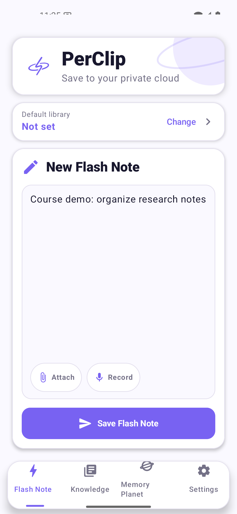
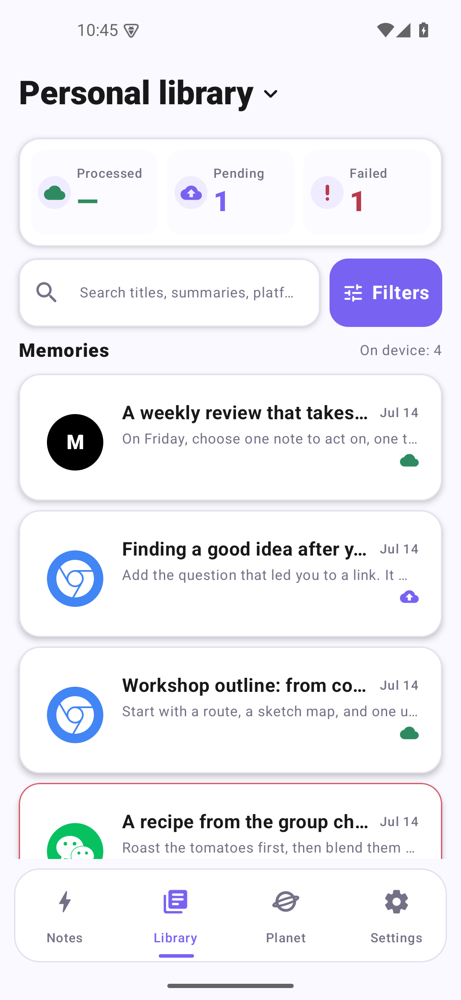
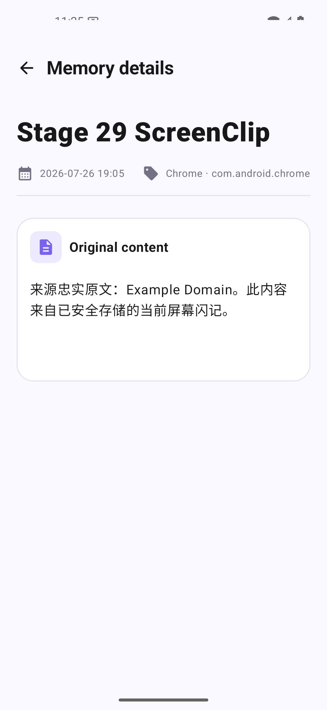
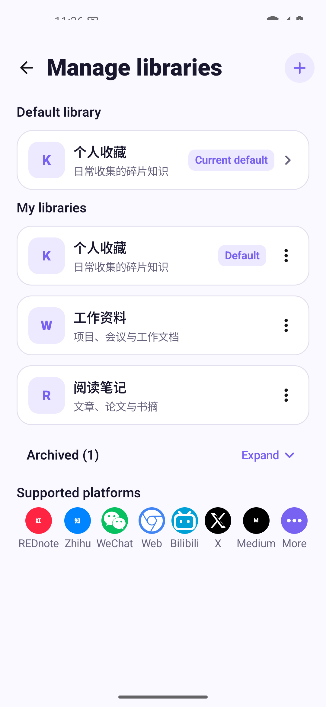
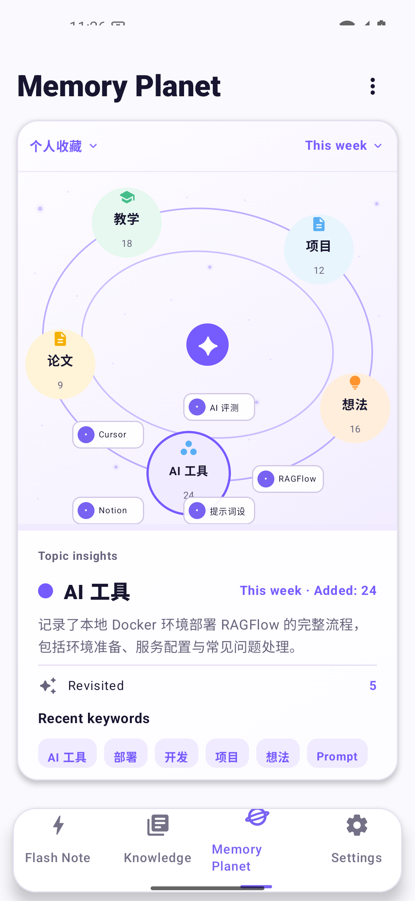

# PerClip RAG Document Management System

[简体中文](README.md) | English

UECS6013 · Group 2 · Document Management System

PerClip is a proposed RAG document management system for document capture, organization, archival, retrieval, and questions answered with source references. This repository holds course project planning and presentation materials.

Start with the [group guideline](GUIDELINE_EN.md). **Collaborate directly in Google Docs, where edits sync in real time. This repository provides English and Chinese reading copies.**

## Prototype preview

Five core screens from the current Android prototype, using synthetic English examples. These illustrate the interface; live RAG answers and completed acceptance testing are not demonstrated. Click an image to enlarge it.

| Capture a note | Browse saved content | Read original content |
| --- | --- | --- |
|  |  |  |
| Write a note, with attachment and recording actions. | View saved items, search by title and open filters. | Open an item to read its original text, source and capture time. |

| Manage libraries | Explore Memory Planet |
| --- | --- |
|  |  |
| Organize content into libraries and choose a default destination. | Browse topic connections and revisit related notes. |

[Full screenshot catalogue](interface-gallery/README.md) · [Per-speaker screenshot cues](presentation/05_Screenshot_Cues_EN.md)

## Documents

| Document | Purpose | Google Docs collaboration draft (English) | English reading copy | 中文 |
|---|---|---|---|---|
| Proposal | Problem, purpose, stakeholders and scope; Task 1 | [Open proposal](https://docs.google.com/document/d/1_qTX6LeHCuEHsDNjiBR0V_AFXNi4oFOH3kq5Kty4Glc) | [English](docs/proposal.md) | [中文](docs/proposal_ZH.md) |
| Team Charter | Members, responsibilities, communication and team rules; Task 1 | [Open team charter](https://docs.google.com/document/d/1QEtU5J5U73wCyGCwEX2-MJFN66VqZpyIB1YgSM_wJv0) | [English](docs/team-charter.md) | [中文](docs/team-charter_ZH.md) |
| Project Charter | MOV, WBS, schedule, budget, risks, quality and acceptance; Task 2 | [Open project charter](https://docs.google.com/document/d/1zFv3wvtZOBagOc8DQkFxFpXOKsy2kZrWi4drkiAovYg) | [English](docs/project-charter.md) | [中文](docs/project-charter_ZH.md) |
| Presentation Script | Five named chapters; leader opens and concludes after ZHANG | [Open shared script](https://docs.google.com/document/d/1BMb5rx9NVIpYG9ox9SPD_6Xkid16asukJab6xNW0ylY) | [English](presentation/01_Final_Presentation_Script_EN.md) | [中文](presentation/01_Final_Presentation_Script_ZH.md) |
| Guideline | Reading order, roles and collaboration | — | [English](GUIDELINE_EN.md) | [中文](GUIDELINE.md) |
| WBS & Budget | Phases, member effort and cost estimates | — | [English](docs/wbs-and-budget.md) | [中文](docs/wbs-and-budget_ZH.md) |
| Presentation Guide | Rehearsal, recording option and Q&A preparation | — | [English](presentation/03_Recording_and_QA_Guide_EN.md) | [中文](presentation/03_Recording_and_QA_Guide_ZH.md) |
| Q&A | Practice answers; not a second presentation script | — | [English](presentation/04_Typical_QA_EN.md) | [中文](presentation/04_Typical_QA_ZH.md) |
| Requirements | Source references, rubric, dates and unresolved questions | — | [English](docs/requirements_EN.md) | [中文](docs/作业要求与准备清单.md) |

Google Docs retain the English collaboration drafts; Chinese copies support understanding. There is one script, with A/B content choices within each chapter; do not read both parts in full. Each page has a language switch at the top.

## Current status

The three formal documents and script are planning drafts pending member review. Matriculation numbers, contacts, actual skills, meeting arrangements and signatures remain blank. Features, MOV, 90 person-hours and MYR 2,585 are plans or estimates, not completed implementation or expenditure.

Task 1 is dated 20 November 2026, Task 2 8 December and Presentation 10 December. The platform's Task 1 00:00 cutoff conflicts with the attachment's 23:59; the internal readiness target is 19 November at 18:00 MYT. Presentation mode, duration and submission format remain unconfirmed; a composite video is not yet approved by the lecturer.

[Original course files](course-source/) remain unchanged. No university submission or message to the lecturer/group has been made. Network-drive synchronization remains pending.

Interface screenshots and per-image descriptions: see [interface-gallery](interface-gallery/README.md). Images are numbered by module and use synthetic sample data; they are not functional acceptance evidence.

Presentation screenshot cues: [English](presentation/05_Screenshot_Cues_EN.md) · [中文](presentation/05_Screenshot_Cues_ZH.md). Match each speaker’s paragraph to the numbered image and a short English introduction.
